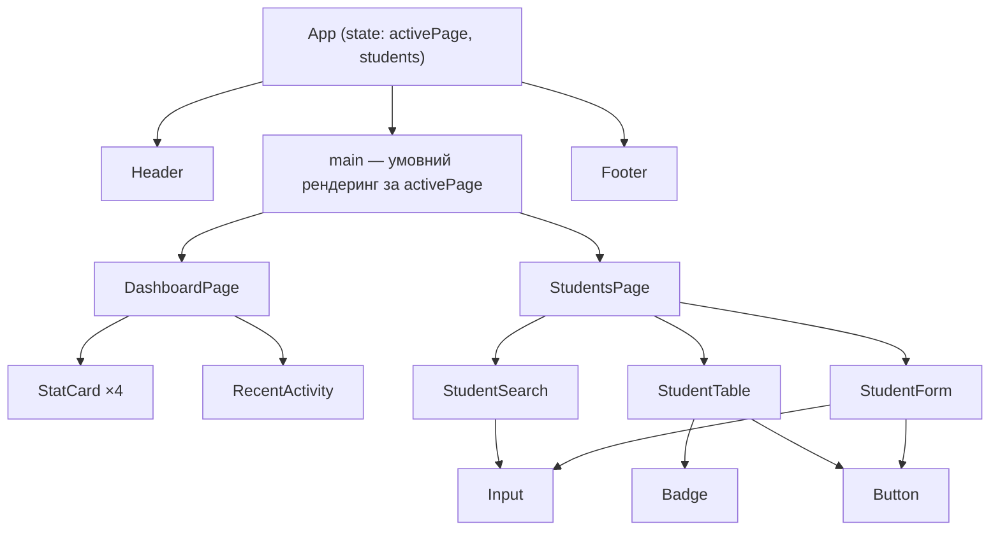
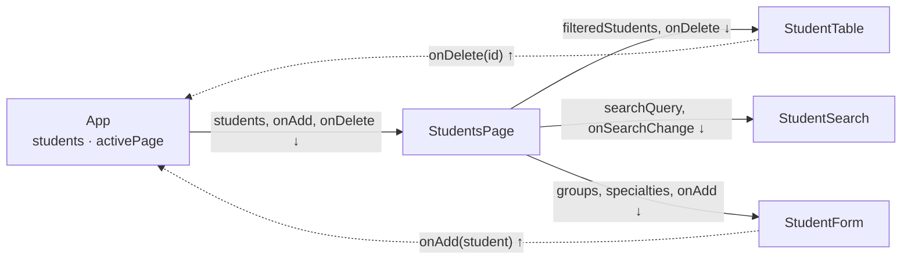

# Практична робота №5. Проєктування архітектури інформаційної системи в React.js

**Тема.** Модульна (компонентна) архітектура ІС університету: Dashboard + модуль управління студентами.
**Що здається.** Схема ієрархії компонентів, структура папок, опис props і state, відповіді на 6 контрольних запитань.
**Реалізація** цієї архітектури — у практичній №6 (`university-is/`), адаптація під варіант — у №7 (`schedule-is/`).

---

## 1. Мета і завдання

**Мета:** вивчити принципи модульної архітектури через створення незалежних компонентів у React.js та набути навичок проєктування компонентної структури ІС.

**Завдання:** налаштувати середовище → спроєктувати ієрархію компонентів → UI-компоненти → Layout-компоненти → Dashboard-компоненти → зібрати повноцінний застосунок.

**Інструменти:** Node.js 18+, VS Code, Google Chrome, термінал.

## 2. Вимоги до системи

| Модуль | Що має вміти |
|---|---|
| Dashboard | 4 картки статистики з трендами; список останніх подій із кольоровою індикацією типу |
| Студенти | таблиця (аватар, ім'я, email, група, спеціальність, курс, GPA, статус); пошук за ім'ям/email; фільтр за групою; форма додавання з валідацією; видалення |
| Загальне | навігація між сторінками; sticky-шапка; підвал із динамічним роком; порожній стан таблиці |

## 3. Принципи компонентної архітектури

| Принцип | Суть | Приклад у системі |
|---|---|---|
| Єдина відповідальність | один компонент — одна задача | `Button` лише малює кнопку й передає клік |
| Перевикористання | написав раз — використовуєш усюди | `Button` у таблиці («Видалити») і у формі («Зберегти») |
| Ієрархічна структура | компоненти утворюють дерево; батьки передають дітям props | `App → StudentsPage → StudentTable → Badge` |
| Односпрямований потік даних | дані вниз через props, події вгору через колбеки | `students` вниз, `onDelete(id)` вгору |

**Ключові інструменти:** `useState` (стан), props (передача даних), JSX (розмітка).

## 4. Типи компонентів

| Тип | Компоненти | Відповідальність | Власний стан |
|---|---|---|---|
| UI | `Button`, `Input`, `Card`, `Badge` | базові елементи інтерфейсу, без бізнес-логіки | ні (stateless) |
| Layout | `Header`, `Footer` | структура сторінки, навігація | ні |
| Dashboard | `StatCard`, `RecentActivity` | відображення статистики й активності | ні |
| Дані (Students) | `StudentTable`, `StudentForm`, `StudentSearch` | відображення та редагування даних студентів | `StudentForm` — так |
| Сторінки | `DashboardPage`, `StudentsPage` | збирають компоненти в розділи | `StudentsPage` — так |
| Корінь | `App` | глобальний стан, композиція | так |

Рівні архітектури: **UI → Layout → Pages → Features**.

## 5. Ієрархія компонентів



Те саме текстом:

```
App (кореневий компонент)
├── Header ─ Logo, Navigation, UserMenu
├── Main Content
│   ├── DashboardPage
│   │   ├── StatCard × 4
│   │   └── RecentActivity
│   └── StudentsPage
│       ├── StudentSearch ── Input
│       ├── StudentTable ─── Badge, Button
│       └── StudentForm ──── Input, Button
└── Footer
```

**4 рівні ієрархії:**

| Рівень | Компоненти | Роль |
|---|---|---|
| 1. Кореневий | `App` | точка входу, глобальний стан |
| 2. Layout і сторінки | `Header`, `Footer`, `DashboardPage`, `StudentsPage` | каркас сторінки та розділи |
| 3. Функціональні | `StatCard`, `RecentActivity`, `StudentSearch`, `StudentTable`, `StudentForm` | логіка конкретної функції |
| 4. Базові UI | `Button`, `Input`, `Card`, `Badge` | перевикористовувані «цеглинки» |

## 6. Структура файлів

```
university-is/
├── src/
│   ├── components/
│   │   ├── UI/          Button · Input · Card · Badge          (.jsx + .css)
│   │   ├── Layout/      Header · Footer                         (.jsx + .css)
│   │   ├── Dashboard/   StatCard · RecentActivity
│   │   └── Students/    StudentTable · StudentForm · StudentSearch
│   ├── pages/           DashboardPage · StudentsPage
│   ├── data/            mockData.js
│   ├── styles/          global.css
│   └── App.jsx
└── package.json
```

| Папка | Призначення |
|---|---|
| `components/UI` | базові перевикористовувані елементи, не залежать від бізнес-логіки |
| `components/Layout` | структурні компоненти, загальний макет |
| `components/Dashboard` | панель управління, аналітика |
| `components/Students` | таблиця, форма, пошук студентів (містять бізнес-логіку) |
| `pages` | збирають менші компоненти в цілі розділи |
| `data` | централізовані тестові дані (імітація БД) |

> У практичній №6 до `Layout` додається `Sidebar` (швидка статистика) і `styles/global.css` з CSS-змінними — так вказано в структурі методички №6.

## 7. Props компонентів

| Компонент | Props | Тип / значення |
|---|---|---|
| `Button` | `text`, `onClick`, `type`, `size`, `disabled` | type: primary \| secondary \| danger \| success; size: sm \| md \| lg |
| `Input` | `label`, `type`, `value`, `onChange`, `error` | type: text \| email \| password \| number |
| `Card` | `title`, `children`, `padding`, `className` | padding: sm \| md \| lg |
| `Badge` | `text`, `type` | type: success \| warning \| danger \| info |
| `Header` | `activePage`, `onNavigate` | рядок; функція |
| `Footer` | — | без props (stateless) |
| `StatCard` | `title`, `value`, `change`, `trend`, `icon`, `color` | trend: up \| down |
| `RecentActivity` | `activities` | масив `{ id, action, name, time, type }` |
| `StudentSearch` | `searchQuery`, `onSearchChange`, `filterGroup`, `onFilterChange`, `groups` | рядки; функції; масив |
| `StudentTable` | `students`, `onDelete` | масив; функція(id) |
| `StudentForm` | `onAdd`, `onCancel`, `groups`, `specialties` | функції; масиви |
| `DashboardPage` | — | дані з `mockData.js` |
| `StudentsPage` | `students`, `onAdd`, `onDelete` | з `App` |

## 8. Управління станом

| Рівень | Де | Змінні | Чому саме тут |
|---|---|---|---|
| Глобальний | `App` | `activePage`, `students` | потрібні кільком гілкам дерева → піднімаємо до найвищого спільного батька |
| Локальний (сторінка) | `StudentsPage` | `searchQuery`, `filterGroup`, `showForm` | потрібні лише цій сторінці |
| Локальний (форма) | `StudentForm` | `formData`, `errors` | стосуються лише введення й валідації |



## 9. Приклади коду

**UI-компонент без стану (`Button`).** Динамічні CSS-класи залежать від props:

```jsx
function Button({ text, onClick, type = 'primary', size = 'md', disabled = false }) {
  const classNames = [
    'btn', `btn-${type}`, `btn-${size}`, disabled ? 'btn-disabled' : ''
  ].filter(Boolean).join(' ');

  return <button className={classNames} onClick={onClick} disabled={disabled}>{text}</button>;
}
```

**Підняття стану (`App`).** Єдине джерело правди про студентів:

```jsx
const [students, setStudents] = useState(studentsData);

const handleAdd = (s) => setStudents(prev => [...prev, s]);
const handleDelete = (id) => setStudents(prev => prev.filter(s => s.id !== id));
```

**Умовний рендеринг сторінки:**

```jsx
<main>
  {activePage === 'dashboard'
    ? <DashboardPage />
    : <StudentsPage students={students} onAdd={handleAdd} onDelete={handleDelete} />}
</main>
```

**Фільтрація за пошуком і групою (`StudentsPage`):**

```jsx
const filtered = students.filter(st => {
  const matchesSearch = st.name.toLowerCase().includes(q) || st.email.toLowerCase().includes(q);
  const matchesGroup = !filterGroup || st.group === filterGroup;
  return matchesSearch && matchesGroup;
});
```

**Відображення списку з `key` (`RecentActivity`):**

```jsx
{activities.map(a => <div key={a.id} className="activity-item">…</div>)}
```

## 10. Відповіді на контрольні запитання

**1. Що таке компонентна архітектура і в чому її переваги?**
Принцип побудови застосунку, за якого інтерфейс розділяється на незалежні самодостатні блоки — компоненти, кожен із яких відповідає за свою частину функціональності. Переваги: перевикористання коду без дублювання; модульність; простота тестування та супроводу; зручна паралельна робота в команді.

**2. Різниця між props та state.**
`props` — вхідні дані, які компонент отримує ззовні (від батька) і не може змінювати (read-only). `state` (`useState`) — внутрішній змінний стан компонента; при його зміні React перемальовує інтерфейс. Props керує батько, state — сам компонент.

**3. Що таке односпрямований потік даних? Приклад.**
Дані рухаються лише зверху вниз — від батьківського компонента до дочірніх через props; для зміни даних дочірній компонент викликає колбек, переданий батьком. У системі: `App` передає `students` вниз у `StudentsPage → StudentTable`, а `StudentTable` викликає `onDelete(id)`, і стан оновлюється в `App`.

**4. Як організована ієрархія компонентів?**
Чотири рівні: (1) `App` — корінь і глобальний стан; (2) Layout і сторінки — `Header`, `Footer`, `DashboardPage`, `StudentsPage`; (3) функціональні компоненти — `StatCard`, `RecentActivity`, `StudentSearch`, `StudentTable`, `StudentForm`; (4) базові UI — `Button`, `Input`, `Card`, `Badge`.

**5. Призначення `mockData.js` і як замінити його реальним API?**
Файл централізує тестові дані, що імітують БД університету, і дозволяє розробляти інтерфейс без бекенду. Для переходу на сервер початкові дані замінюють на асинхронний запит у `useEffect`, а додавання/видалення — на `POST`/`DELETE`:

```jsx
useEffect(() => {
  fetch('/api/students').then(r => r.json()).then(setStudents);
}, []);
```

**6. Принцип єдиної відповідальності на прикладі `Button`.**
`Button` відповідає лише за відображення кнопки та передачу кліку (`onClick`); він не знає, видаляє студента чи зберігає форму. Тому ту саму кнопку використовують скрізь, змінюючи лише props (`text`, `type`, `size`).

## 11. Зв'язок із наступними роботами

- **№6** — реалізація цієї архітектури в коді (`university-is/`).
- **№7** — той самий шаблон, адаптований під варіант «Розклад занять» (`schedule-is/`): ті самі рівні (UI → Layout → Pages → Features), той самий підхід до стану й потоку даних.
