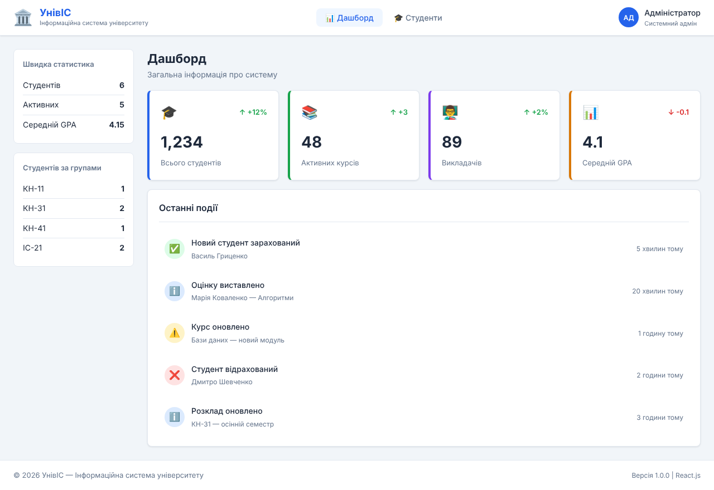
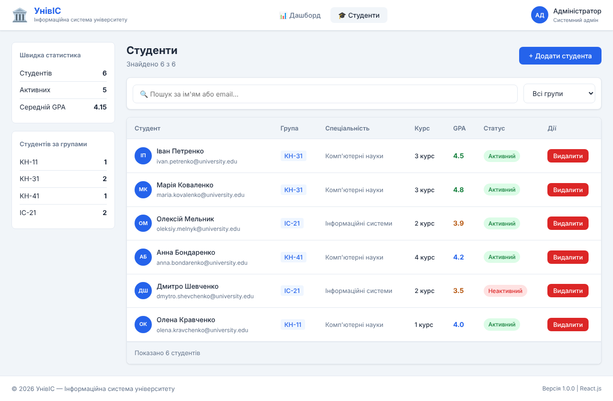
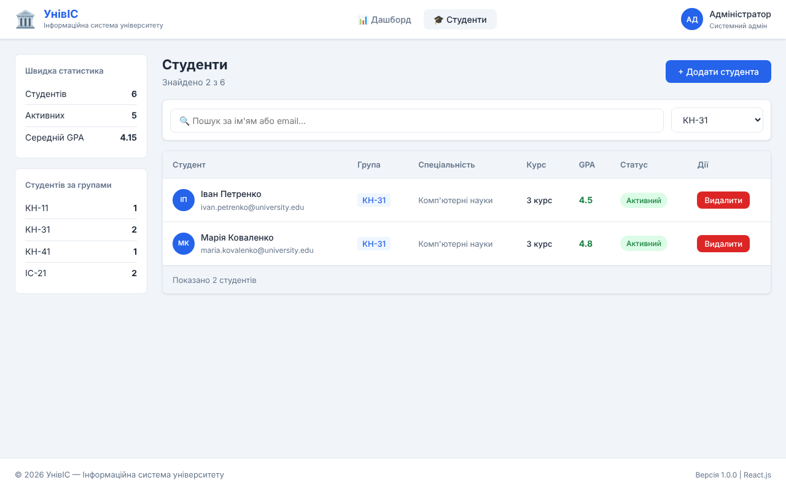
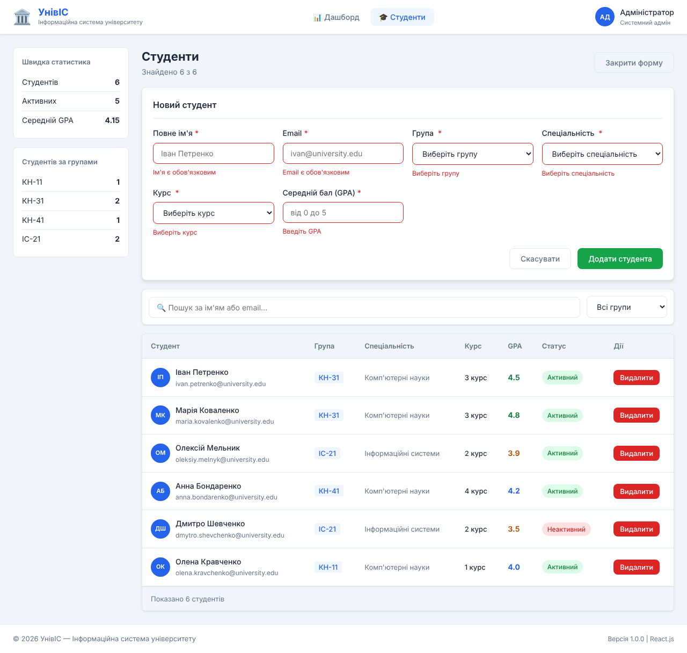
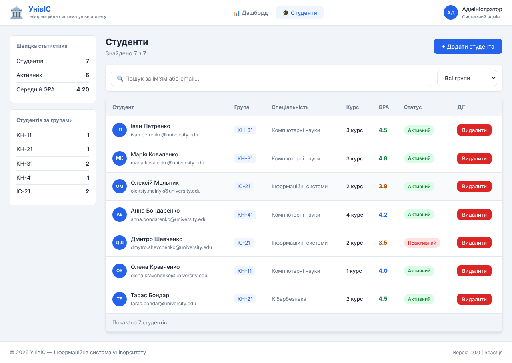

# Практична робота №6. Реалізація ІС університету на React.js

**Тема.** Інформаційна система університету з використанням компонентного підходу.
**Що здається.** Працюючий код (папка `university-is/`) + скріншоти Dashboard, таблиці студентів, пошуку/фільтра та форми додавання.
**Архітектура** описана в [практичній №5](practical-5-architecture.md).

---

## 1. Запуск

Потрібен **Node.js 18+** (`node -v`).

```bash
cd university-is
npm install
npm run dev
```

Відкрийте адресу з термінала (зазвичай http://localhost:5173).

### Відмінності від методички

| У методичці | У проєкті | Чому |
|---|---|---|
| `npx create-react-app university-is` | Vite (`npm install` у готовому проєкті) | Create React App більше не підтримується; Vite швидший |
| `npm start` | `npm run dev` | команда запуску Vite |
| `public/index.html`, `src/index.js` | `index.html` у корені, `src/index.jsx` | вимога Vite; у `.jsx` лежить JSX |

Структура `src/` повністю збігається з методичкою (`components/UI|Layout|Dashboard|Students`, `pages`, `data`, `styles`, `App.jsx`, `App.css`).

## 2. Відповідність етапів методички файлам

| Етап методички | Файли |
|---|---|
| Етап 1. Глобальні стилі та тестові дані | `styles/global.css`, `data/mockData.js` |
| Етап 2. UI-компоненти | `components/UI/` — `Button`, `Input`, `Card`, `Badge` (`.jsx` + `.css`) |
| Етап 3. Layout-компоненти | `components/Layout/` — `Header`, `Sidebar`, `Footer` |
| Етап 4. Dashboard-компоненти | `components/Dashboard/` — `StatCard`, `RecentActivity` |
| Етап 5. Компоненти студентів | `components/Students/` — `StudentSearch`, `StudentTable`, `StudentForm` |
| Збірка застосунку | `pages/DashboardPage.jsx`, `pages/StudentsPage.jsx`, `App.jsx`, `App.css`, `index.jsx` |

Методичка №6 обривається на `StudentForm` і не містить `Sidebar`, сторінок та `App`; їх дописано в тому ж стилі й за схемою з практичної №5 (глобальний стан в `App`, локальний — у `StudentsPage` і `StudentForm`).

## 3. Що перевірити й заскрінити для звіту

**Скріншот 1 — Dashboard.** 4 картки `StatCard` із трендами та список `RecentActivity`; зліва — `Sidebar` зі статистикою.



**Скріншот 2 — Студенти.** Таблиця з аватарами, групою, спеціальністю, курсом, GPA (колір залежить від значення) і статусом.



**Скріншот 3 — Пошук і фільтр.** Виберіть у списку групу `КН-31` (або введіть частину імені чи email).



**Скріншот 4 — Валідація форми.** «+ Додати студента» → «Додати студента» з порожніми полями: під кожним полем з'являється помилка.



**Скріншот 5 — Студента додано.** Заповніть форму коректно; студент з'явиться в кінці таблиці зі згенерованим аватаром (ініціали), а `Sidebar` одразу оновить лічильники.



> Скріншоти в папці `docs/screenshots/practical-6/` зроблені з цього проєкту; для звіту краще зняти власні зі свого запуску.

## 4. Реалізовані можливості

- Навігація Dashboard ↔ Студенти (`activePage`, умовний рендеринг).
- Пошук за іменем/email і фільтр за групою (разом).
- Валідація форми: ім'я (≥ 3 символи), email (регулярний вираз), група, спеціальність, курс, GPA (0–5); помилка зникає під час введення.
- Генерація аватара з ініціалів; додавання в кінець списку; видалення.
- Порожній стан таблиці; «Показано N студентів».
- `Sidebar` рахує статистику з поточного стану, тому реагує на додавання й видалення.

## 5. Покращення порівняно з кодом методички

| Що | Навіщо |
|---|---|
| `Button` має `htmlType` (`button`/`submit`) | кнопка «Додати студента» стає справжнім submit форми |
| `<label htmlFor>` + `useId` в `Input`; `id`/`htmlFor` у `select` | клік по підпису ставить курсор у поле, працює з екранними читачами |
| `noValidate` у формі | перевірку виконує наш код, а не вбудовані підказки браузера (інакше для `abc` у email чи GPA = 7 форма не доходить до нашої валідації) |
| `setStudents(prev => …)` | коректне оновлення стану при швидких діях |
| `Number(gpa).toFixed(1)` | GPA `4` показується як `4.0` |
| `split(/\s+/)` для аватара | не ламається на зайвих пробілах в імені |
| `aria-label` на пошуку, фільтрі, кнопках «Видалити» | доступність |
| Темніші кольори тексту в `Badge` і GPA | кращий контраст |
| Адаптивність (`@media`) | шапка, `Sidebar` і таблиця коректні на вузьких екранах |

## 6. Відповіді на контрольні запитання

Ті самі шість запитань, що в практичній №5, — відповіді див. у розділі 10 [документа №5](practical-5-architecture.md#10-відповіді-на-контрольні-запитання).
