# Практична робота №7. Індивідуальний проєкт — «Розклад занять»

**Варіант:** 5 — 🏫 Розклад занять (групи, викладачі, аудиторії).
**Підхід:** шаблон із практичних №5–6 (компонентна архітектура, props вниз / колбеки вгору, глобальний стан у `App`) адаптовано під нову предметну область.
**Код:** папка `schedule-is/`.

---

## 1. Запуск

```bash
cd schedule-is
npm install
npm run dev
```

Node.js 18+. Збірка: `npm run build`.

## 2. Предметна область

Система допомагає навчальному відділу складати тижневий розклад: яка **група**, у якій **аудиторії**, з яким **викладачем** і коли проводить заняття.

### Сутності

| Сутність | Поля | Приклад |
|---|---|---|
| Група (`group`) | `id`, `name`, `specialty`, `year`, `studentsCount` | КН-31, Комп'ютерні науки, 3 курс, 24 студенти |
| Викладач (`teacher`) | `id`, `name`, `position`, `department`, `email` | Шевченко Т. І., доцент, кафедра ІС |
| Аудиторія (`room`) | `id`, `number`, `building`, `capacity`, `type` | 301, Корпус 2, 30 місць, комп'ютерний клас |
| Заняття (`lesson`) | `id`, `subject`, `type`, `groupId`, `teacherId`, `roomId`, `day`, `slot` | Бази даних, лекція, КН-31, Вт, 1 пара |

Заняття зв'язує три сутності за `id`: це «таблиця зв'язків», як у реляційній БД. Дні — `1…5` (Пн–Пт), пари — `1…5` (08:30–16:25).

### Бізнес-правила (перевіряються у `utils/schedule.js → findConflicts`)

1. Група не може мати дві пари одночасно.
2. Викладач не може вести дві пари одночасно.
3. Аудиторія не може бути зайнята двома заняттями одночасно.
4. Аудиторія має вміщати всю групу (`capacity ≥ studentsCount`).
5. Групу, викладача чи аудиторію не можна видалити, поки в розкладі є пов'язані заняття (кнопка неактивна, у підказці — скільки занять).

## 3. Як шаблон University IS адаптовано

| University IS (№5–6) | Schedule IS (№7) | Зміни |
|---|---|---|
| Сутність «студент» | сутності «група», «викладач», «аудиторія», «заняття» | чотири набори даних замість одного |
| `StudentsPage` | `SchedulePage`, `GroupsPage`, `TeachersPage`, `RoomsPage` | одна сторінка → чотири розділи |
| `StudentTable` | `GroupTable`, `TeacherTable`, `RoomTable`, `ScheduleGrid` | таблиці + тижнева сітка |
| `StudentForm` | `GroupForm`, `TeacherForm`, `RoomForm`, `LessonForm` | у `LessonForm` — перевірка конфліктів |
| `StudentSearch` (пошук + фільтр) | `SearchBar` (пошук), `ScheduleFilter` (режим + об'єкт) | універсальний пошук; фільтр за групою/викладачем/аудиторією |
| `StatCard` (тренд) | `StatCard` (примітка) | показники рахуються з даних, а не статичні |
| `RecentActivity` (статичний) | `RecentActivity` (живий журнал) | `App` додає подію після кожної дії |
| — | `WeekLoad` | діаграма навантаження по днях |
| — | `Select` (UI) | випадаючі списки більше не дублюються у формах |
| `Header` із навігацією | `Header` (семестр, користувач) + `Sidebar` (навігація, лічильники) | п'ять розділів зручніше в бічній панелі |
| `mockData.js` | `mockData.js` + `constants.js` | довідники днів, пар і типів винесено окремо |
| — | `utils/schedule.js` | чисті функції логіки без React |

Незмінними лишилися: `Button`, `Input`, `Card`, `Badge`, `RecentActivity`, `Footer`, `global.css` та правило «стан піднято в `App`».

## 4. Ієрархія компонентів

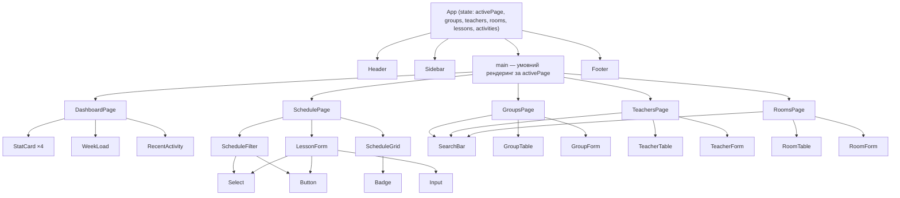

## 5. Структура файлів

```
schedule-is/
├── index.html · package.json · vite.config.js
└── src/
    ├── components/
    │   ├── UI/          Button · Input · Select · Card · Badge
    │   ├── Layout/      Header · Sidebar · Footer
    │   ├── Dashboard/   StatCard · WeekLoad · RecentActivity
    │   ├── Schedule/    ScheduleFilter · ScheduleGrid · LessonForm
    │   ├── Groups/      GroupTable · GroupForm
    │   ├── Teachers/    TeacherTable · TeacherForm
    │   ├── Rooms/       RoomTable · RoomForm
    │   └── Common/      SearchBar · Table.css · Form.css
    ├── pages/           DashboardPage · SchedulePage · GroupsPage · TeachersPage · RoomsPage
    ├── data/            mockData.js · constants.js
    ├── utils/           schedule.js
    ├── styles/          global.css
    ├── App.jsx · App.css · index.jsx
```

Усього: 5 UI + 3 Layout + 3 Dashboard + 3 Schedule + 6 (Groups/Teachers/Rooms) + 1 Common = **21 компонент**, 5 сторінок, `App`.

## 6. Props ключових компонентів

| Компонент | Props |
|---|---|
| `Select` | `label`, `value`, `onChange`, `options[{value,label}]`, `placeholder`, `error`, `required` |
| `Sidebar` | `activePage`, `onNavigate`, `counts{schedule,groups,teachers,rooms}` |
| `StatCard` | `title`, `value`, `note`, `icon`, `color` |
| `WeekLoad` | `data[{id,short,name,count}]` |
| `ScheduleFilter` | `mode`, `onModeChange`, `targetId`, `onTargetChange`, `groups`, `teachers`, `rooms` |
| `ScheduleGrid` | `lessons`, `mode`, `groups`, `teachers`, `rooms`, `onDelete`, `onCellClick(day, slot)` |
| `LessonForm` | `groups`, `teachers`, `rooms`, `lessons`, `preset`, `onAdd`, `onCancel` |
| `GroupTable` / `TeacherTable` / `RoomTable` | `groups`\|`teachers`\|`rooms`, `lessons`, `onDelete` |
| `GroupForm` | `groups` (для перевірки унікальності), `onAdd`, `onCancel` |
| `TeacherForm` | `onAdd`, `onCancel` |
| `RoomForm` | `rooms` (для перевірки унікальності), `onAdd`, `onCancel` |
| `SearchBar` | `value`, `onChange`, `placeholder`, `label` |

## 7. Стан застосунку

| Рівень | Де | Змінні |
|---|---|---|
| Глобальний | `App` | `activePage`, `groups`, `teachers`, `rooms`, `lessons`, `activities` |
| Локальний | `SchedulePage` | `mode`, `targetId`, `showForm`, `preset`, `notice` |
| Локальний | `GroupsPage`, `TeachersPage`, `RoomsPage` | `query`, `showForm` |
| Локальний | `LessonForm` та інші форми | `formData`, `errors` (+ `conflicts` у `LessonForm`) |

Чому всі довідники в `App`: їх використовують кілька сторінок одночасно — `Dashboard` рахує показники, `SchedulePage` будує сітку, `LessonForm` пропонує списки, `Sidebar` показує лічильники. Це типовий випадок «підняття стану».

Обробники в `App` (`handleAddLesson`, `handleDeleteGroup`…) оновлюють стан і дописують подію в журнал (`logActivity`).

## 8. Скріншоти для звіту

**1. Dashboard** — показники рахуються зі стану, діаграма навантаження, журнал подій.
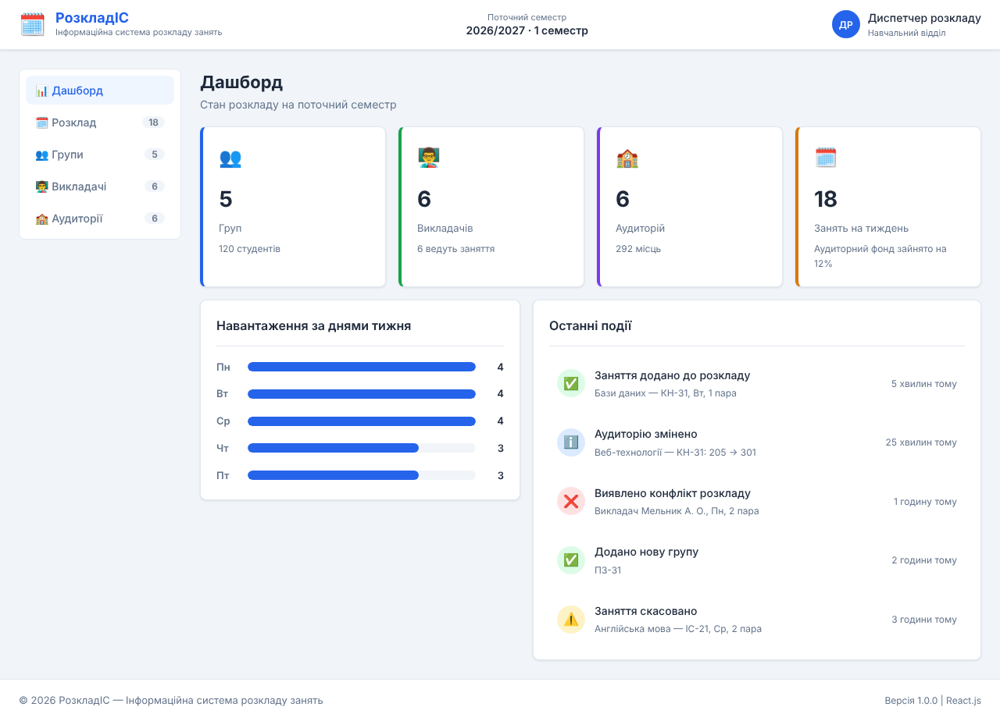

**2. Розклад за групою** — тижнева сітка; колір смуги — тип заняття.
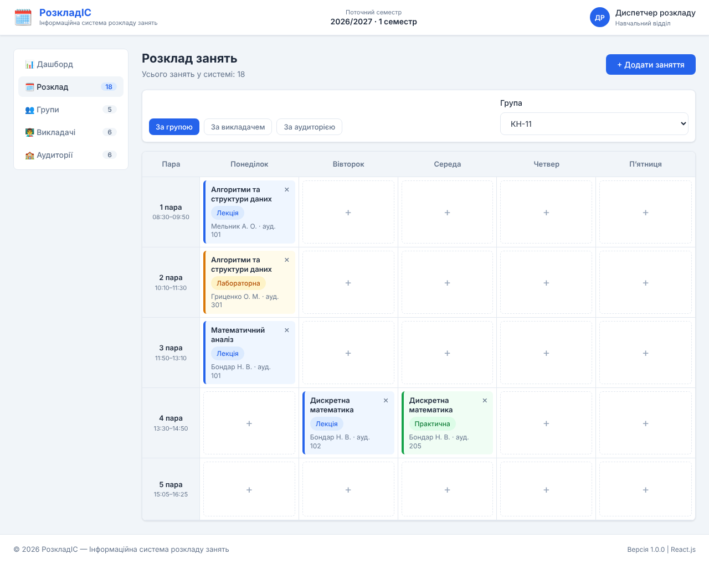

**3. Розклад за викладачем** — та сама сітка, інший режим (другий рядок картки показує групу й аудиторію).
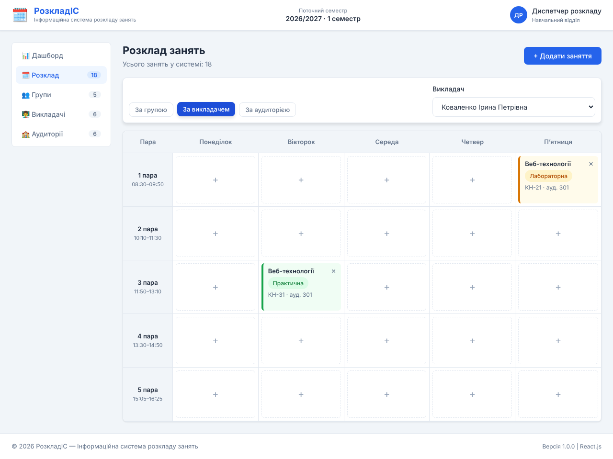

**4. Конфлікт розкладу** — спроба додати заняття, що збігається за групою, викладачем і аудиторією.
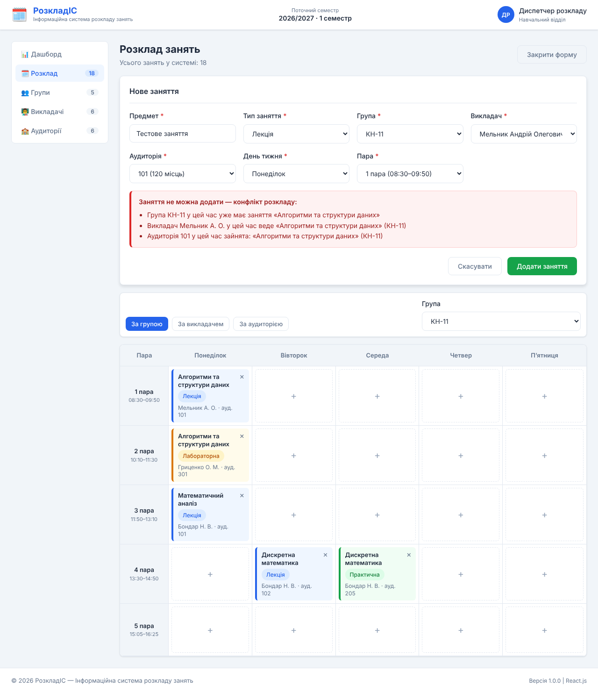

**5. Форма з підставленими даними** — клік по порожній клітинці «+» (Пн, 4 пара) підставляє групу, день і пару.
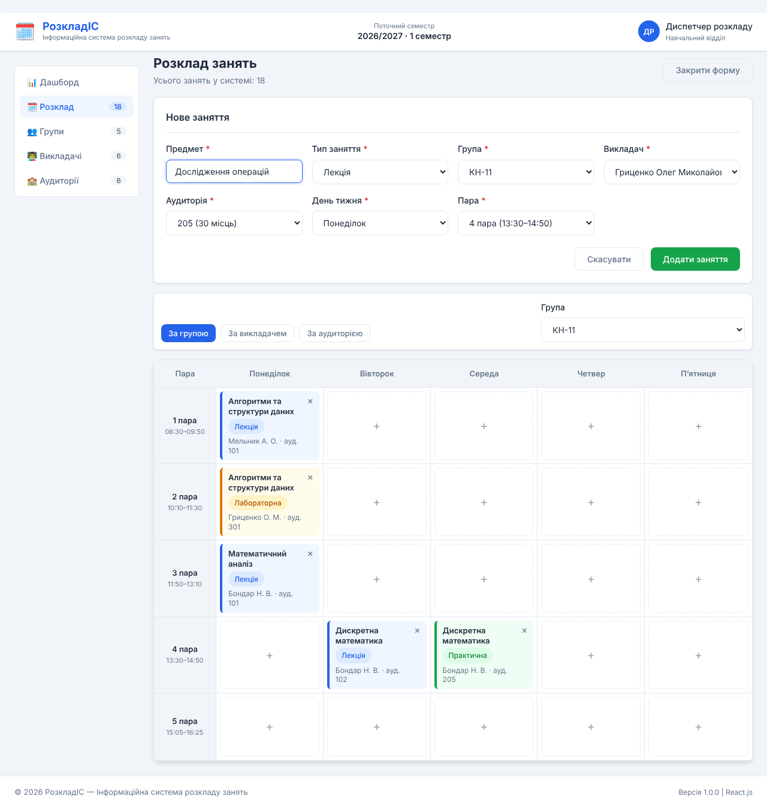

**6. Заняття додано** — повідомлення про успіх і нова картка в сітці.
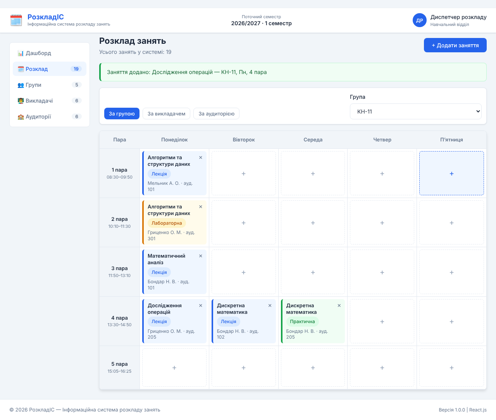

**7–9. Групи, викладачі, аудиторії** — пошук, додавання з валідацією, видалення (неактивне, якщо є заняття).
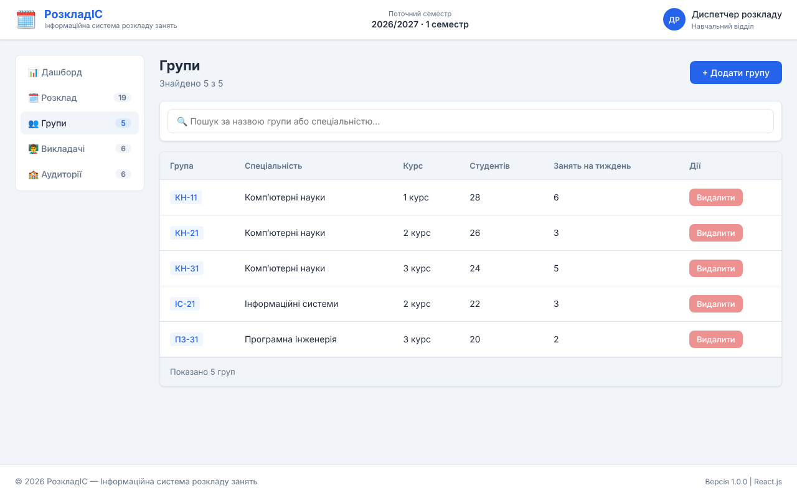
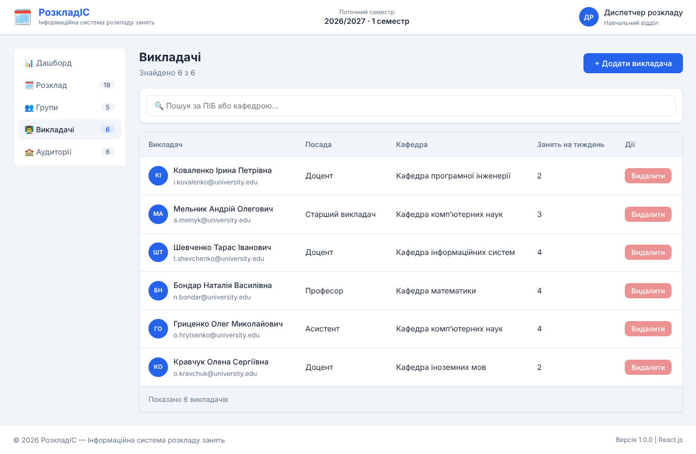
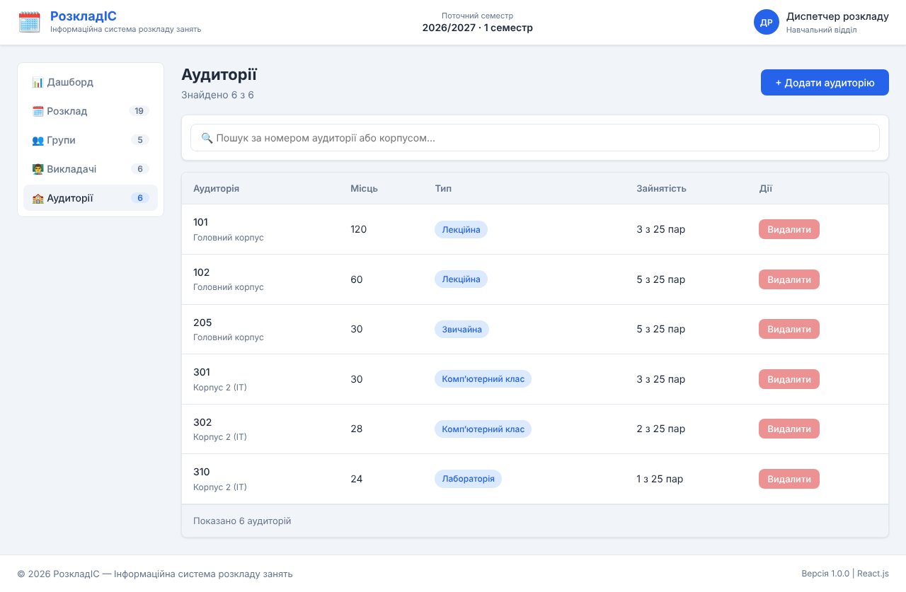

**10. Dashboard після змін** — лічильники та журнал оновилися.
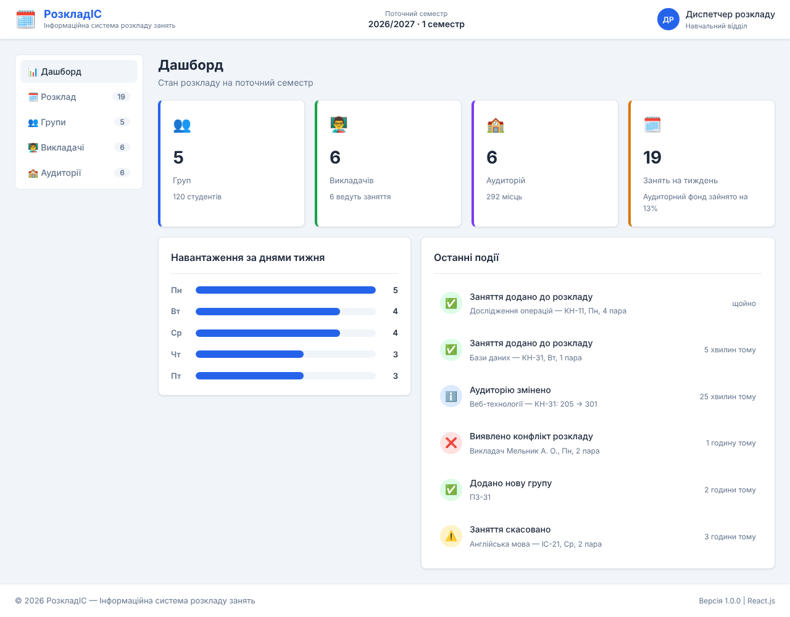

## 9. Питання для захисту

**Як працює перевірка конфліктів?**
`findConflicts(lessons, candidate, {groups, teachers, rooms})` відбирає заняття з тим самим днем і парою, а потім шукає серед них збіг за `groupId`, `teacherId`, `roomId`; окремо порівнює `capacity` аудиторії з `studentsCount` групи. Повертає масив повідомлень — порожній, якщо додавати можна. Функція чиста (без React), тому її легко тестувати.

**Чому `id` — рядки, а не числа?**
Значення `<select>` завжди рядки. Рядкові `id` (`'g1'`, `'t2'`) не потребують перетворень і не ламають порівняння `===`. День і пару, навпаки, зберігаємо числами (`Number(...)` при створенні заняття), бо їх порівнюють і впорядковують.

**Чому видалення групи/викладача/аудиторії заблоковане, якщо є заняття?**
Інакше в занять з'явилися б «висячі» посилання на неіснуючі сутності (аналог порушення зовнішнього ключа в БД). Кнопка неактивна, у підказці — кількість пов'язаних занять; додатковий захист є і в обробнику `App`.

**Де зберігається стан і чому саме там?**
Довідники й заняття — в `App`, бо потрібні кільком сторінкам. Пошук, вибраний режим і видимість форми — локально в сторінках, бо інші компоненти про них не знають.

**Як працює режим перегляду?**
`SchedulePage` зберігає `mode` і `targetId`; `filterLessons` залишає заняття, у яких `lesson[ключ] === targetId` (ключ — `groupId`, `teacherId` або `roomId`). `ScheduleGrid` отримує вже відфільтрований масив і лише малює, а в картці показує дві інші сутності.

**Як замінити `mockData.js` на реальний API?**
Початкові значення станів замінити на `useEffect` із `fetch`, а `handleAdd…`/`handleDelete…` — на `POST`/`DELETE`-запити з оновленням стану після відповіді сервера. Правила конфліктів варто дублювати на сервері.

## 10. Можливий розвиток

Редагування занять; зберігання в `localStorage` або на сервері; перетягування занять мишею; розклад по тижнях (парний/непарний); експорт у PDF/Excel; перевірка вікон у викладача.
